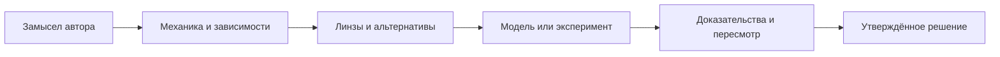

<div align="center">


[Русский](../README.md) · [English](../README.en.md) · [Портфолио-кейс](../docs/PORTFOLIO.md)

[](https://github.com/IgorKramar/ludoscope/actions/workflows/quality.yml)
[](../LICENSE)
[](../package.json)

**Проектируйте опыт игрока. Проверяйте правила. Сохраняйте основания решений.**

</div>

LUDOSCOPE — локальный инструмент геймдизайна для Codex и внешних агентов. Он связывает механику с авторским замыслом, зависимостями, проверяемыми источниками и экспериментами. Общее ядро TypeScript доступно через CLI, MCP и программный API.

| Попробовать | Подключить | Изучить |
| :--- | :--- | :--- |
| [Демо с отчётом за один запуск](../docs/DEMO.md) | [Установка в Codex](../README.md#установка-в-codex) | [Архитектура и решения](../ARCHITECTURE.md) |
| Реальные расчёты и сохранённые входные данные | 17 Skills, 40 MCP-инструментов | [API для WORLD FORGE](../docs/API.md) |

## От идеи к решению

> «Хочу добавить голод: пусть он поддерживает планирование экспедиций».



Инструмент проверяет заданные правила, показывает ограничения вывода и помогает подготовить следующий эксперимент. Автор определяет желаемый опыт и принимает решение.

## Что можно проверить самому

| Направление | Работающий результат |
| :--- | :--- |
| **Знания** | 208 записей, 19 источников, постраничное происхождение выбранных пересказов |
| **Системы** | Граф зависимостей, ресурсные модели, seed, инварианты, чувствительность |
| **Исследования** | Гипотезы, планы экспериментов, CSV/JSON и описательная оценка измерений |
| **Память** | Профиль проекта, версии артефактов, неизменяемые записи решений |
| **Интеграция** | Строгие схемы, ссылки на доказательства, сохранение project/task IDs |
| **Качество** | CI на Node.js 22/24, реальные MCP transports, проверка установленного пакета |

```sh
git clone https://github.com/IgorKramar/ludoscope.git
cd ludoscope
npm ci --ignore-scripts
npm run check
npm run demo
```

Последняя команда создаёт отдельную временную папку с Markdown-отчётом, полными JSON-данными и контрольными суммами. Повторный запуск создаёт новый результат.

## Четыре игровых контекста

| Пример | Исследуемый вопрос |
| :--- | :--- |
| [Survival](../examples/survival/README.md) | Как голод связан с пищей, погодой и автоматизацией? |
| [Card roguelike](../examples/card-roguelike/README.md) | Какие комбинации и варианты выбора допускают правила? |
| [Economic tycoon](../examples/economic-tycoon/README.md) | Что происходит с ресурсами при заданных производственных процессах? |
| [Narrative strategy](../examples/narrative-strategy/README.md) | Согласованы ли события с объявленными состояниями мира? |

## Статус проекта

**0.5.0 — рабочее ядро с усиленной проверкой ссылок и воспроизводимым демо.** [Изменения](../CHANGELOG.md) · [Проверки](../TESTING.md) · [Ограничения](../LIMITATIONS.md).

Симуляция проверяет модель; опыт реальных игроков требует плейтеста. FIP пока предварительный, Chronicler подключается через необязательный адаптер. Полные коммерческие книги и OCR не распространяются. Полная приёмка версии 1.0 остаётся в [roadmap](../ROADMAP.md).

---

[Игорь Крамар](https://github.com/IgorKramar) · Продуктовый замысел и требования; разработка в сотрудничестве с Codex.  
[Методология](../METHODOLOGY.md) · [Знания и происхождение](../KNOWLEDGE.md) · [Вклад в проект](../CONTRIBUTING.md)
