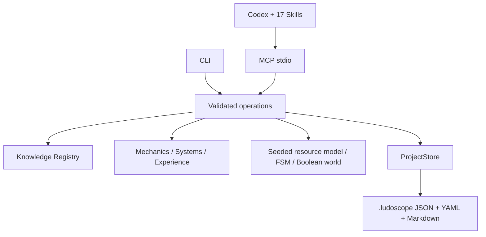

# Архитектура

Версия пакета 0.4.0. Knowledge Registry 1.1 (чтение 1.0 сохранено); проектные и MCP envelope-контракты 1.0. Архитектурные решения и проверенные официальные спецификации: [ADR](docs/architecture/decisions.md).

`src/core/schemas.ts` — Zod-контракты. `schemas/` генерируется сборкой, включая отдельные input/output для каждого MCP-инструмента. `src/core/operations.ts` связывает аргументы, ядро и ProjectStore; `results.ts` проверяет результаты до передачи клиенту. CLI и MCP переиспользуют те же библиотеки; CLI файловые операции дополнительно ограничены корнем.

`src/core/knowledge.ts` лениво загружает реестр один раз за процесс. Поиск использует токены Unicode и веса совпадений заголовка, тегов, описания; это релевантность поиска, не истинность. Векторный поиск можно реализовать через RetrievalProvider. Локальные пользовательские пакеты читаются из `.ludoscope/knowledge/*.registry.json`; коллизии ID и одинаковые описания отклоняются.

`src/project/store.ts` создаёт project.yaml, vision.md, principles.md и design-graph.json. Остальные каталоги появляются при реальном использовании. Контекст содержит исходные требования, канон, mode, граф и утверждённые решения; черновики и исходные observations остаются отдельными артефактами пользователя. Решения не изменяются: новое решение получает новый ID и ссылается на пересматриваемый контекст.

Граф различает типы узлов и связей. Для Requires/DependsOn запрещены циклы. Reinforces/Counters и другие связи могут образовывать петли; анализ SCC выявляет компоненты, но не выводит знак и устойчивость без модели. Impact — консервативная связность с путями, не доказанная причинность.

При сканировании возвращаются инвентарь и хеши, а не содержимое всех файлов. Маркеры движков — только свидетельства структуры. Нет достоверного автоматического извлечения игровых правил из кода. Design-code traceability задаётся `nodes[].files`, связями Implements/Validates и утверждениями с evidence; полнота не предполагается.

Запись осуществляется только init, explicit import/report и record_decision(commit=true). Временный файл синхронизируется, затем атомарно публикуется через hard link без перезаписи; существующее имя отклоняется. Путь проверяется на traversal и symlink. Поведение при конкурентной атаке на родительские каталоги и неполной инициализации описано в LIMITATIONS.

Публичные интерфейсы находятся в `src/core/extensions.ts`, SimulationProvider — в `src/simulation/index.ts`. Никакая запись знаний не загружается как исполняемый модуль. UniversalModderAdapter — интерфейс будущей интеграции, реальный API не предполагается.

Версионируемые артефакты сохраняются в `.ludoscope/{mechanics,experiments,playtests,hypotheses,documents}/<id>/v<version>.json` через record_artifact. Context включает индекс путей и версий, не загружая все тела. Mechanics Analysis по ID читает последнюю сохранённую версию. Версия утверждённого документа или наблюдение не изменяет статус гипотезы автоматически.

update_graph возвращает preview с expected_sha256. Commit требует этот хеш, использует эксклюзивный lockfile, сохраняет прежний текст в history/<sha256>.json и атомарно заменяет граф. Несовпадение хеша отклоняется: пользователь должен увидеть новый preview. После аварии lock может потребовать ручной проверки перед удалением.

## Углублённая база 0.2

Source.provenance и Entry.evidence отделяют проверку библиографии, конкретной пользовательской копии и содержания выбранного фрагмента. Новые записи ссылаются на 1-based PDF-позиции; хеши идентифицируют файл, не дают доступ к книге. Авторские методы и сравнения не могут иметь scope author_position автоматически.

`core/retrieval.ts` выполняет только лексическую нормализацию. `core/lenses.ts` применяет selection и объясняет контекстную привязку. Строковые conditions всё ещё требуют интерпретации Codex; они не объявляются вычисленными причинными правилами. Контекст механики ограничен восемью релевантными записями с резервом для разных школ; точечный knowledge_get загружает до20 записей/источников.

Mastery operation переиспользует неизменённый structural mastery core, затем добавляет ограниченный context через registry и проектные фильтры. PDF/OCR не являются runtime-зависимостью. Optional source audit использует отдельный readability guard: повторяющиеся колонтитулы и watermark-only извлечения не принимаются за содержательный текст; это не доказательство OCR-точности или истинности авторских выводов.

## WORLD FORGE Integration Layer

`src/integration/` содержит публичный LudoscopeAgentApi, DesignKnowledgeEngine, AnalysisEngine, RecommendationEngine, EvaluationEngine, FIP schemas и ChroniclerAdapter. Это логические модули общего процесса, переиспользующие существующие mechanics/systems/labs/simulation. MCP сервер регистрирует 24 старых операции и 16 новых; совместимость старого wrapper сохранена. Агентные ответы используют отдельный FIP envelope непосредственно в structuredContent. CLI по-прежнему работает через прежнее ядро; агентная интеграция доступна MCP и библиотеке.

`contracts/fip/v1/` генерируется из Zod; api_version 1.0 предварительная, profile=ludoscope.fip-v1-draft.1. Новый API знает author_goals, creative_principles, constraints и project/task correlation. Он возвращает кандидатные спецификации и не переписывает авторские решения. Вызовы Chronicler ограничены timeout и требуют хостового клиента; публикация отдельно авторизуется. Конкретное официальное подключение не заявляется.

Подробности: [API](docs/API.md), [WORLD FORGE](docs/WORLD_FORGE_INTEGRATION.md), [Chronicler](docs/CHRONICLER_INTEGRATION.md).
