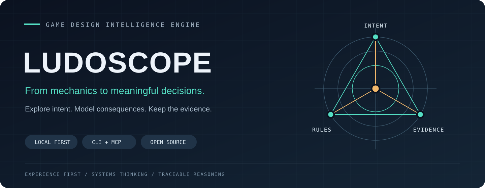

# LUDOSCOPE — от игровой идеи к проверяемому решению

**Game Design Intelligence Engine**  
Codex Plugin · CLI · MCP · TypeScript · Local-first

[Код](https://github.com/IgorKramar/ludoscope) · [Запустить демо](DEMO.md) · [Архитектура](../ARCHITECTURE.md) · [API](API.md)

## Проблема

Игровая механика меняет несколько систем одновременно. Голод влияет на маршруты, производство пищи, обучение и темп. Новая карта меняет комбинации и доступность стратегий. Дизайнеру нужно понимать, какие решения получит игрок и на чём основаны рекомендации.

LUDOSCOPE связывает авторский замысел с формальной спецификацией, зависимостями, источниками и экспериментами. Автор сохраняет право на сложное или необычное решение.

## Что создано

Общее ядро TypeScript работает через CLI, MCP и программный API. Codex Skills организуют творческую и аналитическую работу; вычислительные модули проверяют явно заданные правила.

| Компонент | Зачем нужен | Проверяемый артефакт |
| :--- | :--- | :--- |
| Knowledge Registry | Выбирать релевантные знания и сохранять происхождение | [Реестр и лицензии](../KNOWLEDGE.md) |
| Design Graph | Находить затронутые механики, ресурсы и ограничения | [Граф survival](../examples/survival/graph.json) |
| Systems Lab | Повторять расчёты и проверять инварианты | [Ресурсная модель](../examples/survival/economy.json) |
| Project Memory | Сохранять контекст и историю решений | [Хранилище](../src/project/store.ts) |
| Integration Layer | Передавать результат следующему агенту | [FIP-контракты](../contracts/fip/v1/README.md) |

Состав версии 0.5.0: **40 MCP-инструментов, 17 Skills, 208 записей знаний**. Эти числа описывают реализацию; творческое качество требует отдельной оценки.

## Кейс: голод и планирование экспедиции

Авторское намерение — ограниченная еда должна создавать выбор подготовки и маршрута. [Исполняемый демонстрационный сценарий](DEMO.md) проверяет узкую часть задачи: накопление ресурсов.

При исходных правилах ферма даёт 2 единицы пищи за такт, питание расходует 1. Запас растёт с 5 до 15 и трижды нарушает заданную границу 12. В кандидате ферма производит 1: итоговый запас 5, нарушений нет.

Это воспроизводимое сравнение параметров. Чтобы принять кандидат, ещё нужно проверить темп подготовки и выбор маршрутов с реальными игроками.

Runner передаёт фактическое число нарушений в API с происхождением `simulation`. Гипотеза не превращается в подтверждённый факт; результат относится к условиям модели. Весь цикл сохраняется в JSON, Markdown и manifest с контрольными суммами.

## Инженерные решения

**Один источник реализации.** CLI, MCP и библиотечный API вызывают общие модули. Строгие Zod-схемы экспортируются в JSON Schema для внешних агентов.

**Неизменность доказательств.** Разные записи с одним ID отклоняются. Следующая итерация сохраняет артефакты прошлых доказательств. Изменение авторской цели создаёт новое определение гипотезы; прежний результат остаётся связан с прежней гипотезой.

**Корректная интерпретация критериев.** Если у гипотезы несколько обязательных условий, итог формируется совместно: все выполнены, хотя бы одно нарушено либо данных недостаточно. Происхождение человеческих, инженерных и модельных данных сохраняется.

**Работа при недоступной памяти.** Необязательный ChroniclerAdapter проверяет проект, ссылки и лимиты. Недоступная или некорректная история даёт частичный результат с явным ограничением, сохраняя локальный анализ.

**Явное изменение проекта.** Preview отделён от записи. Утверждённые решения не перезаписываются; удалённая публикация требует разрешения хоста.

## Что показывает качество

[GitHub Actions](https://github.com/IgorKramar/ludoscope/actions/workflows/quality.yml) выполняет сборку и тесты на Node.js 22/24, проверяет соответствие сгенерированных схем, относительные ссылки документации, агентный workflow, настоящий stdio MCP и установленный npm-пакет. Демо-отчёты сохраняются как artifacts запуска.

[Проверка 0.5.0](verification-0.5.0.md) зафиксировала 95/95 тестов и полный прогон на Node.js 22/24, включая установленный пакет. [Численные результаты демо](demo-0.5.0.json) сохранены отдельно.

[Исторический отчёт 0.4.0](verification-0.4.0.md) отдельно фиксирует установку в Codex CLI 0.159.2. Новый CI не подменяет этот факт заявлением о проверке всех клиентов.

Не проводились реальные плейтесты, независимая оценка творческого качества Skills или коммерческое внедрение. Тестовый сценарий не выдаётся за кейс выпущенной игры.

## Авторство и развитие

Игорь Крамар сформулировал продуктовый замысел, требования и направление развития. Разработка выполняется в сотрудничестве с Codex; результаты доступны для проверки по коду, схемам, тестам и отчётам.

Следующий содержательный этап — пилот на реальном игровом проекте: идея → спецификация → реализация → измерения → пересмотр. Отдельные направления — согласование FIP, официальный API Chronicler, полная локализация и расширение проверенных источников.

[Roadmap](../ROADMAP.md) · [Ограничения](../LIMITATIONS.md) · [Вклад в проект](../CONTRIBUTING.md)
