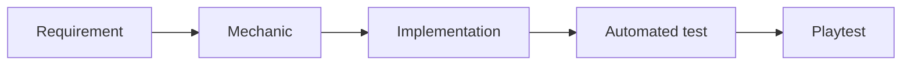

# Design–code traceability: от требования к проверяемым файлам

LUDOSCOPE проверяет явно объявленные связи между требованием, механикой, реализацией и свидетельствами проверки. Аудит отвечает на два разных вопроса: **какие этапы связаны в manifest** и **сохранились ли привязанные файлы в проверяемой рабочей копии**.



Связи задаёт автор manifest. Совпавший хеш подтверждает байтовую идентичность файла; он не доказывает, что код реализует требование, тест проверяет нужное поведение или плейтест действительно проводился.

## Запуск

После сборки, из каталога LUDOSCOPE:

```sh
node dist/cli/index.js --project /absolute/path/to/game trace /absolute/path/to/traceability.json
```

Аргумент `trace` разрешается относительно текущего рабочего каталога CLI. Пути `artifacts[].path` разрешаются относительно `--project`. Это позволяет хранить manifest в LUDOSCOPE и проверять внешний игровой репозиторий без записи в него.

MCP-инструмент `ludoscope_check_traceability` принимает `{ "manifest": { ... } }`. Корень определяется настройкой сервера. Результат использует прежний core-wrapper `{schema_version, operation, result}`; отдельный FIP-envelope для этой операции не вводится.

Аудит читает файлы и при необходимости метаданные Git. Он не запускает игру, автоматизированные тесты, скрипты сборки или команды из manifest.

## Manifest 1.0

| Поле | Значение |
| :--- | :--- |
| `schema_version` | `"1.0"` |
| `id` | Устойчивый идентификатор manifest |
| `revision` | Необязательный полный Git commit hash: 40 или 64 строчных шестнадцатеричных символа |
| `artifacts` | От 1 до 100 записей |
| `links` | До 500 объявленных связей `{from, to}` |

Каждый артефакт содержит:

| Поле | Правило |
| :--- | :--- |
| `id` | Уникальный стабильный ID |
| `kind` | `requirement`, `mechanic`, `implementation`, `automated_test` или `playtest` |
| `path` | Относительный путь внутри проверяемого корня |
| `sha256` | SHA-256 полных исходных байтов файла, 64 строчных hex-символа |
| `lines` | Необязательный локатор `{start, end}`: строки с 1, обе границы включены |

Хеш относится ко **всему файлу**, даже если указан диапазон строк. Изменение вне диапазона тоже делает привязку устаревшей. Конечный перевод строки не добавляет отдельную пустую строку; пустой файл имеет ноль строк. Для диапазона нужен корректный UTF-8. Бинарный файл можно идентифицировать хешем без локатора.

Допустимы только переходы между соседними этапами в указанном направлении. Например, `requirement → implementation` не заменяет отсутствующую спецификацию механики. Повторяющиеся ID, одинаковые пары связей, отсутствующие цели ссылок и недопустимые переходы отклоняются при проверке структуры.

## Учебный пример без плейтеста

Следующий скрипт создаёт новый временный каталог с четырьмя артефактами и вычисляет настоящие хеши. Это учебные файлы, а не результаты разработки выпущенной игры. Файл автоматизированного теста создаётся, но не запускается.

```sh
node --input-type=module <<'JS'
import { mkdtemp, writeFile } from "node:fs/promises";
import { createHash } from "node:crypto";
import { tmpdir } from "node:os";
import { join } from "node:path";

const root = await mkdtemp(join(tmpdir(), "ludoscope-trace-"));
const files = [
  ["requirement", "requirement.md", "# Requirement\nRemember the selected route.\n"],
  ["mechanic", "mechanic.json", '{"id":"mechanic.route","rule":"Store the selected route"}\n'],
  ["implementation", "route.mjs", "export const chooseRoute = (route) => ({ route });\n"],
  ["automated_test", "route.test.mjs",
    'import assert from "node:assert/strict";\nimport { chooseRoute } from "./route.mjs";\nassert.deepEqual(chooseRoute("east"), { route: "east" });\n'],
];
const artifacts = [];
for (const [kind, path, content] of files) {
  await writeFile(join(root, path), content, { flag: "wx" });
  artifacts.push({
    id: kind + ".route", kind, path,
    sha256: createHash("sha256").update(content).digest("hex"),
  });
}
const manifest = {
  schema_version: "1.0", id: "trace.route", artifacts,
  links: artifacts.slice(1).map((artifact, i) => ({
    from: artifacts[i].id, to: artifact.id,
  })),
};
await writeFile(join(root, "traceability.json"), JSON.stringify(manifest, null, 2));
console.log("Project root: " + root);
console.log("Manifest: " + join(root, "traceability.json"));
JS
```

Передайте напечатанные пути команде `trace`. Файловые привязки могут быть `current`, а цепочка останется неполной: этап `playtest` отсутствует. Это корректный результат. Не добавляйте вымышленный отчёт ради формально полной цепочки.

После изменения `route.mjs` повторный аудит должен показать `stale` для реализации. Неизменившийся файл теста при этом может оставаться `current`: аудитор не проверяет, запускался ли он после изменения реализации.

## Чтение результата

Результат имеет `claim_type: PROJECT_FACT`: фактом здесь является результат проверки файлов и объявленных отношений, а не оценка игрового опыта.

### Привязки файлов

| `bindings[].status` | Что установлено |
| :--- | :--- |
| `current` | Полный хеш совпал; указанный локатор допустим |
| `stale` | Содержимое отличается от ожидаемого хеша |
| `missing` | Файл отсутствует |
| `blocked` | Путь отклонён политикой доступа, включая символические ссылки |
| `unreadable` | Файл не удалось прочитать |
| `invalid_range` | Файл совпал, но локатор нельзя применить к его тексту |
| `budget_exceeded` | Чтение остановлено ограничением ресурсов |

В привязке также доступны ожидаемый и фактический хеши, размер, число строк и `diagnostics`. Если одновременно изменился файл и нарушен диапазон, основной статус — `stale`, а диагностика объясняет обе проблемы. Отсутствующее измерение обозначается `null`.

### Покрытие требований

Для каждого требования `coverage` содержит:

- `declared_chain` — существует объявленный путь через все пять этапов.
- `current_chain` — существует такой путь, на котором все файловые привязки имеют статус `current`.
- `missing_stages` — недостающие этапы объявленной цепочки.
- `chain_artifact_ids` — один найденный полный объявленный путь; пустой массив, если такого пути нет.

`unlinked_artifact_ids` показывает артефакты, недостижимые ни из одного объявленного требования. Связь между двумя файлами реализации и теста сама по себе не связывает их с дизайнерским требованием. Полная объявленная цепочка может быть устаревшей; отсутствие пропущенных этапов не означает актуальность файлов.

Общий `status: complete` требует хотя бы одного требования, актуальности всех привязок, актуальной полной цепочки для каждого требования и отсутствия несвязанных артефактов. Если задана Git-ревизия, дополнительно нужны её совпадение и чистая рабочая копия. Остальные допустимые результаты имеют `status: partial`. Значение `complete` описывает эту проверку, не полноту игрового дизайна.

Manifest только с внешними исходниками допускается: `coverage` будет пустым, все его артефакты будут отмечены как не связанные с требованиями, а результат останется `partial`. Это полезно для честного начального аудита чужой кодовой базы.

### Ревизия Git

| `revision.status` | Интерпретация |
| :--- | :--- |
| `unpinned` | Ревизия не задана; Git не проверяется, `actual` и `dirty` равны `null` |
| `match` | HEAD совпадает с указанным commit hash |
| `mismatch` | HEAD отличается |
| `unavailable` | Проверить Git-метаданные не удалось |

`dirty` сообщает о найденных изменениях рабочей копии. Игнорируемые файлы и внутренние изменения submodule не входят в эту проверку. Совпадение HEAD не заменяет файловые хеши: рабочее содержимое может отличаться от коммита.

Необязательная ревизия позволяет работать без Git. Поэтому `complete` при `unpinned` означает проверку файлов и цепочек без подтверждения Git-контекста.

## Изменения и свидетельства

Изменение исходника делает его прежнюю файловую привязку устаревшей. Исторический результат теста остаётся свидетельством своего запуска; его применимость к новой реализации нужно установить повторно. Аудитор не переписывает прошлые результаты и не объявляет их ложными.

При изменении механики:

1. Просмотрите изменившиеся файлы и затронутую цепочку.
2. Уточните спецификацию и соответствие авторскому замыслу.
3. Запустите нужные проверки отдельно и сохраните их реальные условия, ревизии и результаты.
4. Подготовьте новую версию manifest с проверенными хешами и связями.
5. Если пересматривается утверждённое решение, оформите новую связанную запись.

Не заменяйте все хеши автоматически ради зелёного статуса. Совпадение нового хеша не подтверждает корректность изменений. Проверка traceability сама ничего не записывает в канон, manifest или исходники игры.

## Пилот Hydrocraft

[Пилот](../examples/hydrocraft-pilot/README.md) использует публичный репозиторий [HydrocraftReinvented](https://github.com/IgorKramar/HydrocraftReinvented), закреплённый на ревизии `c2b72c30f52be23eb3d4d25d60d53a1974af6cea`.

Рассматривается цепочка хлопок → нить → ткань: рецепты расходуют веретёна, а callback возвращает три. Модель LUDOSCOPE — самостоятельное формальное описание выбранных правил. Исходный код и игровые assets не копируются в распространяемый пакет.

```sh
npm run pilot:hydrocraft -- --source ../hydrocraft-readonly --output /tmp/hydrocraft-report
```

`--source` обозначает отдельную локальную рабочую копию, доступную только для чтения в рамках этого сценария. Без `--source` выполняется только автономная модель; проверка внешних исходников явно не проводится. Для `--output` используйте новый каталог.

Пилот не подтверждает выполнение callback внутри игры, соблюдение всех движковых правил или опыт реальных игроков. Недостающие связи с тестами и плейтестами сохраняются в отчёте как ограничения, а не заполняются предположениями.

## Ресурсы и доступ

Ограничения: 100 артефактов, 500 связей, 2 MiB на файл и 20 MiB на чтение. Повторное обращение к тому же пути использует результат чтения в рамках аудита. Бюджет резервируется консервативно: близко к пределу возможен отказ даже для небольшого следующего файла.

Абсолютные пути, выход за корень и символические ссылки блокируются. Проектный каталог должен быть доверенным: аудит не даёт транзакционного снимка при конкурентной замене файлов процессом того же пользователя. Git вызывается только фиксированными командами проверки HEAD и состояния, когда задана ревизия.

Библиотечная функция `auditTraceability(root, input, signal?)` принимает необязательный `AbortSignal`. Отмена проверяется перед чтением файлов и проверкой Git; отменённый вызов отклоняется. Данные manifest не интерпретируются как инструкции.

## English usage

Build LUDOSCOPE, then run `node dist/cli/index.js --project /path/to/game trace /path/to/manifest.json`. The manifest path is relative to the CLI working directory; artifact paths are relative to the inspected project root.

The audit verifies declared links, full-file hashes, optional line ranges and an optional Git revision. It does not execute tests or establish semantic correctness. `complete` means the declared coverage and file checks passed; it does not prove a successful playtest or an enjoyable game.

[Архитектура](../ARCHITECTURE.md) · [MCP](../MCP.md) · [Ограничения](../LIMITATIONS.md)
