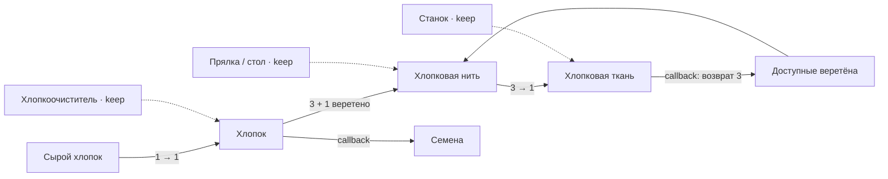

# Hydrocraft Reinvented · хлопок и оборот веретён

**Пилот на реальном игровом репозитории:** статические правила → ограниченная модель → проверяемые гипотезы → план проверки в игре.

Рассматривается [Hydrocraft Reinvented](https://github.com/IgorKramar/HydrocraftReinvented), порт Hydrocraft на Project Zomboid Build 42. Закреплённая ревизия: [`c2b72c30f52be23eb3d4d25d60d53a1974af6cea`](https://github.com/IgorKramar/HydrocraftReinvented/tree/c2b72c30f52be23eb3d4d25d60d53a1974af6cea).

Пилот читает выбранные исходные данные и исследует их отдельную модель. Он не меняет мод, не запускает Project Zomboid и не утверждает, что проведён плейтест. Авторский принцип проекта — дополнять ванильные системы Build 42 — сохраняется как ограничение исследования.

## Почему выбрана эта цепочка

В трёх декларациях рецептов находится только часть ресурсного поведения. Дополнительные семена и возврат веретён задаются Lua-callback-функциями.

| Шаг | Расходуется | Декларативный выход | Дополнительный выход callback | Сохраняется |
| :--- | :--- | :--- | :--- | :--- |
| Process Cotton | 1 сырой хлопок | 1 хлопок | 1 семя хлопка | Хлопкоочиститель |
| Make Cotton Thread | 3 хлопка + 1 веретено | 1 хлопковая нить | — | Прялка или закреплённый стол |
| Make Cotton Cloth | 3 хлопковые нити | 1 хлопковая ткань | 3 веретена | Ткацкий станок или напольный станок |

Это самостоятельно сформулированное извлечение фактов из указанных файлов, а не перенос исходного кода мода. Каждое количество связано с [источником, строками и SHA-256](sources.json).

Веретено в этой цепочке расходуется на промежуточный продукт, затем возвращается. Оно не эквивалентно постоянно сохраняемому инструменту. Если анализировать только блоки `outputs`, можно ошибочно предсказать безвозвратное расходование веретён и пропустить семена.



## Что формализовано

[Модель](economy.json) начинает с 18 единиц сырого хлопка, трёх веретён и доступных станций. За один такт проверяются процессы очистки, прядения и ткачества в этом порядке, не более одного срабатывания каждого.

Сохраняемая станция выражена в модели как одинаковое количество на входе и выходе. Это техническое представление условия наличия; оно не означает, что станция уничтожается и создаётся заново в игре. Семена и веретёна в выходах модели требуют успешного вызова исследованных callback-функций.

**18 тактов здесь — 18 проходов планировщика, не 18 секунд и не 18 игровых минут.** Исходные поля `time` равны 15, 15 и 1000; модель не оценивает длительность, производительность в реальном времени или удобство ожидания.

### Результаты ограниченной модели

| Начальные веретёна | Ткань после 18 проходов | Нить в конце | Обработанный хлопок в конце | Свободные веретёна в конце |
| ---: | ---: | ---: | ---: | ---: |
| 0 | 0 | 0 | 18 | 0 |
| 1 | 0 | 1 | 15 | 0 |
| 2 | 0 | 2 | 12 | 0 |
| 3 | 2 | 0 | 0 | 3 |

Эти результаты воспроизведены симулятором и закреплены автоматическими тестами. Они не являются измерениями игрового клиента. Во всех четырёх сценариях предполагается 18 семян при успешных callback-вызовах.

Два проверяемых баланса на каждом шаге:

- Свободные веретёна + хлопковые нити = начальный запас веретён.
- Сырой хлопок + хлопок + 3 × нить + 9 × ткань = 18 условных единиц хлопка.

Второй баланс — учёт эквивалентов внутри выбранной цепочки, а не физической массы. Другие рецепты, начальная нить или внешнее поступление веретён изменяют границы вывода.

## Воспроизведение базовой модели

Из корня собранного LUDOSCOPE:

```sh
npm run pilot:hydrocraft
# Проверка исходников без изменения мода; нужна чистая копия закреплённой ревизии:
npm run pilot:hydrocraft -- --source ../hydrocraft-readonly
# Только аудит fingerprints, manifest читается из текущего каталога:
node dist/cli/index.js --project ../hydrocraft-readonly trace examples/hydrocraft-pilot/source-traceability.json
```

Для проверки источников требуется отдельно доступная копия закреплённого репозитория. [source-traceability.json](source-traceability.json) содержит только внешние implementation-артефакты и их контрольные суммы. Он намеренно не заявляет полную цепочку «требование → механика → код → тест → плейтест». [sources.json](sources.json) содержит также оригинальные формулировки фактов, точные ссылки и условия преобразования в модель.

Исходный код, Lua-файлы и графические ресурсы Hydrocraft в этот каталог не включены. Его можно использовать офлайн для вычисления модели; проверка соответствия закреплённым файлам требует самих файлов.

## Вывод для геймдизайна

Условие стартового запаса может быть осознанной частью производственной системы. Само наличие порога в три веретена не устанавливает дефект.

Проверяемое дизайнерское направление — помочь игроку увидеть, какой запас временно занят в промежуточных продуктах. Возможные варианты: показать полный бюджет партии, объяснить возврат инструмента либо сохранить открытие закономерности в текущем виде. [Постановка исследования](requirements.md) задаёт альтернативы и отделяет модельную гипотезу от гипотезы об опыте игрока.

Требуется реальная проверка интерфейса и инвентаря после каждого рецепта, включая журнал ошибок callback. Затем можно исследовать, способны ли игроки предсказать запас и осмысленно решить, когда запускать партию. В пилоте таких данных нет.

## Файлы и происхождение

| Файл | Назначение |
| :--- | :--- |
| [requirements.md](requirements.md) | Оригинальная постановка, критерии, авторские ограничения и план исследования |
| [mechanic.json](mechanic.json) | Формальная спецификация выбранной механики с обозначенными гипотезами |
| [economy.json](economy.json) | Ограниченная ресурсная модель |
| [sources.json](sources.json) | Закреплённая ревизия, SHA-256, строки, факты и ограничения |
| [source-traceability.json](source-traceability.json) | Проверка файлов внешней реализации; покрытие намеренно частичное |

README исходного проекта называет Hydromancerx, Hydrocraft Continued team и hombrehumor и явно указывает отсутствие общей лицензии на весь мод. MIT LUDOSCOPE распространяется на наши оригинальные аналитические материалы и код, не переопределяя права на Hydrocraft, Project Zomboid или сторонние ресурсы.

Полный аудит мода, реальная доступность рецептов, загрузка callbacks, влияние других модов, игровая экономика и качество пользовательского опыта остаются за пределами этой модели.

Runner сохраняет report.md, analysis.md, data.json и manifest.json в новой папке. Можно задать `--output /tmp/hydrocraft-report`; существующая папка не заменяется, путь внутри исходного checkout запрещён. Без `--source` соответствие внешним файлам не проверяется. При `--source` дополнительно проверяются пять файлов из sources.json, включая README с авторскими принципами.
